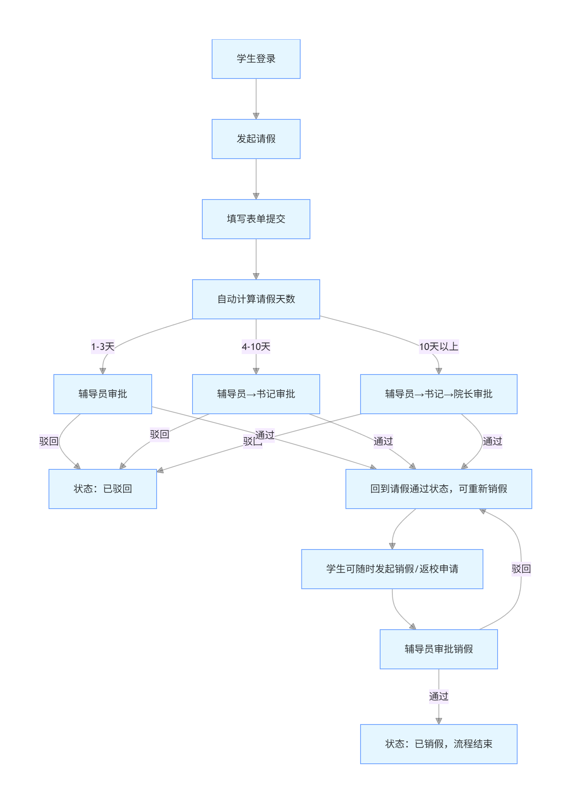
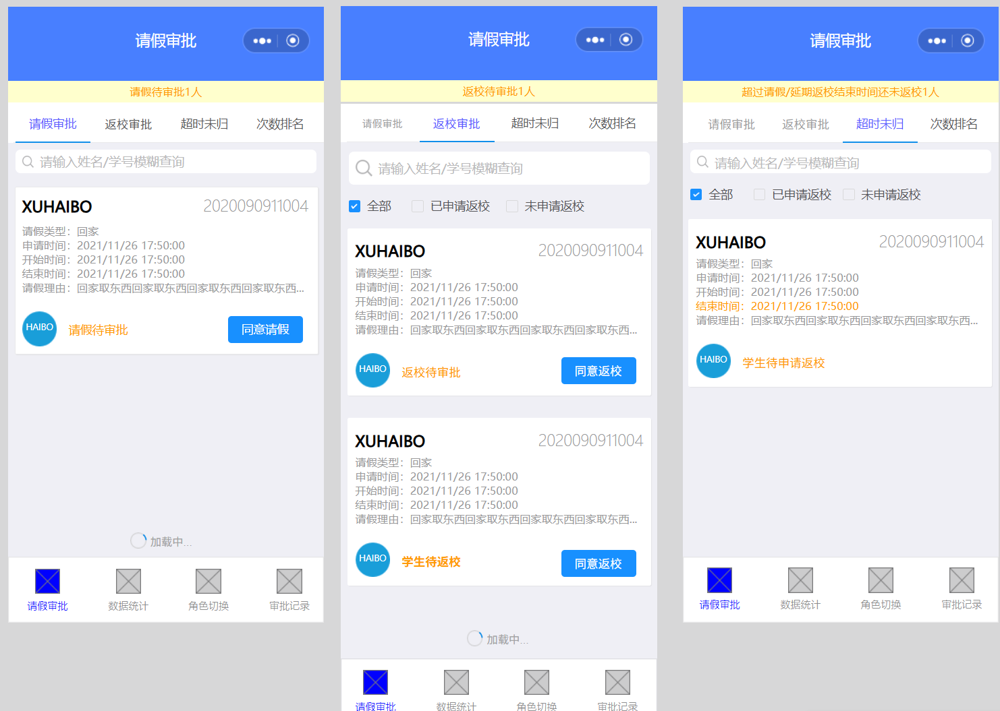
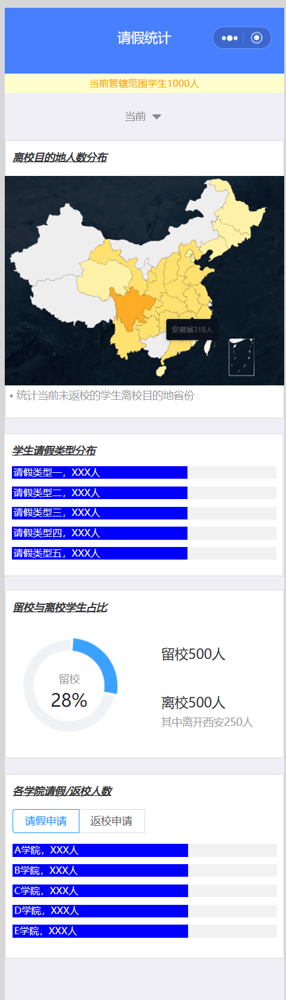

# 学生请销假系统

一个面向高校请假、审批、返校和销假场景的全栈课程团队项目。项目包含学生端与管理端 H5、Spring Boot 后端、MySQL 数据库、Android WebView 测试壳以及 Playwright 接口/UI 自动化测试。

> 说明：该项目为团队协作成果，本仓库用于技术学习与求职作品展示。已移除学生名单、签到表、真实数据库备份和个人文档；仓库内账号与数据均为测试数据。

## 功能亮点

- 学生端：登录与首次改密、请假申请、附件、记录查询、续假、返校和销假。
- 管理端：独立认证、分级审批、返校/续假处理、审批记录和数据统计。
- 安全与权限：学生端与管理端会话隔离、路由拦截、CORS 配置和权限边界回归测试。
- 测试体系：覆盖接口契约、认证授权、输入边界、UI 关键流程和 Android WebView 兼容性。

## 技术栈

| 分层 | 技术 |
| --- | --- |
| 前端 | Vue 3、Vite、Vue Router、Pinia、Element Plus、ECharts |
| 后端 | Java 8、Spring Boot 2.7、MyBatis-Plus |
| 数据库 | MySQL 5.7 / 8.x |
| 自动化测试 | Playwright |
| 移动端验证 | Android WebView、Gradle |

## 系统流程



## 界面预览

| 学生发起请假 | 管理端审批 | 数据统计 |
| --- | --- | --- |
|  |  |  |

## 项目结构

```text
.
├─ frontend/          # Vue 3 H5 学生端与管理端
├─ backend/           # Spring Boot REST API 与数据库初始化
├─ software-testing/  # Playwright 接口/UI/移动端测试
├─ android-webview/   # Android WebView 测试壳
└─ docs/screenshots/  # 流程与原型图
```

## 本地运行

### 1. 启动后端

确保本地已安装 JDK 8+、Maven 3.6+ 和 MySQL，然后按需要设置数据库环境变量：

```powershell
$env:DB_URL='jdbc:mysql://localhost:3306/student_leave_system?createDatabaseIfNotExist=true&useUnicode=true&characterEncoding=utf8&serverTimezone=Asia/Shanghai&useSSL=false&allowPublicKeyRetrieval=true'
$env:DB_USERNAME='root'
$env:DB_PASSWORD='your-password'
mvn -f backend/pom.xml spring-boot:run
```

开发环境默认用户名为 `root`，密码为空；建议始终通过环境变量传入本机密码。

### 2. 启动前端

```powershell
npm --prefix frontend install
npm --prefix frontend run dev
```

访问 `http://127.0.0.1:5173`。Vite 会将 `/api` 代理到 `http://localhost:8080`。

### 3. 运行自动化测试

```powershell
npm --prefix software-testing install
npx --prefix software-testing playwright install chromium
npm --prefix software-testing test
```

测试工程会自动启动前后端。更多测试设计、用例和缺陷记录见 [software-testing/README.md](software-testing/README.md)。

## 测试账号

| 类型 | 账号 | 初始密码 |
| --- | --- | --- |
| 学生 | `2024000001` | `123456` |
| 管理员 | `admin001` | `123456` |

仅用于本地测试，请勿将该凭据用于真实环境。

