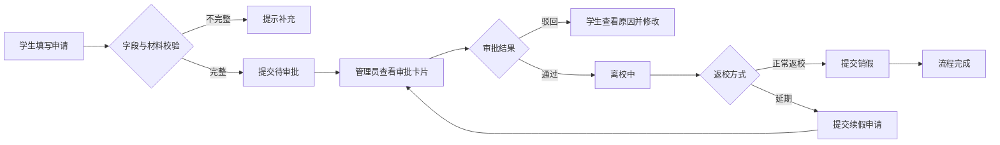

# 学生请销假系统 PRD

| 项目 | 内容 |
| --- | --- |
| 文档版本 | V1.0 |
| 产品负责人 | 项目组产品/测试角色 |
| 目标用户 | 学生、辅导员、学院管理员 |
| 产品形态 | 移动端 H5 + 管理端 Web/H5 |
| 当前状态 | MVP 已上线在线演示 |

## 1. 背景与问题

高校请假流程通常依赖纸质表单、群聊或多个表格协作，学生无法及时获知审批进度，辅导员需要重复核对时间、事由、目的地和历史记录，返校后的销假也容易遗漏。产品需要把“申请—审批—离校—返校—销假”串成一条可追踪的业务链路。

## 2. 产品目标

1. 将学生请假、续假、返校和销假统一到一个移动端流程中。
2. 为管理人员提供待办优先级、审批记录和统计视图，降低人工核对成本。
3. 通过权限、状态和审计记录保证数据安全与责任可追溯。
4. 为后续 AI 辅助审核预留结构化字段、风险规则和人工确认入口。

## 3. 用户画像与核心场景

### 学生

临时请假、就医、回家或实习外出，需要快速提交申请，查看审批进度，并在返校后完成销假。

### 辅导员

每天处理多条申请，需要快速确认申请人、时间、事由、材料和历史记录，处理返校和续假异常。

### 学院管理员

需要查看跨班级统计，识别长期未返校、频繁请假和审批积压等问题。

## 4. 用户故事

- 作为学生，我希望填写一次请假信息后能看到实时状态，避免反复询问老师。
- 作为学生，我希望在预计返校时间变化时发起续假或返校申请，避免线下补手续。
- 作为辅导员，我希望在一张审批卡片中看到关键事实和材料，快速完成同意、驳回或补充信息。
- 作为管理员，我希望按学院、时间和请假类型查看统计，及时发现异常趋势。

## 5. 信息架构

```text
学生端
├─ 请假申请
│  ├─ 请假类型 / 时间 / 目的地 / 事由 / 附件
│  └─ 提交结果与状态时间线
├─ 请假记录
│  ├─ 进行中 / 已通过 / 已拒绝 / 已完成
│  └─ 详情 / 续假 / 返校 / 销假
└─ 个人中心

管理端
├─ 请假审批
├─ 返校审批
├─ 超时未归
├─ 审批记录
├─ 数据统计
└─ 角色切换
```

## 6. 核心流程



## 7. 功能需求与验收标准

### FR-01 请假申请

学生填写请假类型、开始/结束时间、目的地、事由和附件后提交。

**验收标准：**必填项为空时不可提交；结束时间不得早于开始时间；提交成功后状态为“待审批”；重复点击不会生成重复申请。

### FR-02 审批处理

管理员在审批卡片中查看申请详情，可同意并上报或驳回并填写原因。

**验收标准：**只有具备管理员会话的用户可处理；处理后学生端状态同步；审批人、时间和意见进入审批记录；已处理申请不可重复审批。

### FR-03 返校与续假

学生可在符合状态和时间规则时申请返校或续假，管理员在独立待办中处理。

**验收标准：**不符合状态时隐藏或禁用入口；续假必须填写新的结束时间和理由；返校成功后进入已完成状态。

### FR-04 统计分析

管理员按时间、学院、请假类型查看离校、返校和未归统计。

**验收标准：**统计口径和时间范围明确；空数据有空状态；页面刷新后数据一致；敏感字段不出现在聚合图表中。

## 8. AI 产品化需求（V1.1 规划）

| 能力 | 输入 | 输出 | 人工控制 |
| --- | --- | --- | --- |
| 请假摘要 | 事由、时间、地点、附件 | 结构化摘要 | 可编辑、保留原文 |
| 风险提示 | 历史记录、时间冲突、材料状态 | 风险等级与证据 | 仅提示，不自动拒绝 |
| 意见草拟 | 审批结果、学校规则 | 可编辑审批意见 | 确认后才提交 |
| 自然语言统计 | 受控问题 | 带口径的统计结果 | 无法识别时回退筛选器 |

## 9. 指标与埋点

- 业务效率：平均初审时长、待审批积压量、返校销假完成率。
- 用户体验：申请提交成功率、补充材料率、状态查询咨询量。
- AI 质量：摘要采纳率、风险提示误报率、意见修改率、低置信度回退率。
- 安全质量：越权拦截率、审计日志完整率、敏感字段脱敏率。

## 10. 风险与非目标

- AI 不能替代管理员做最终审批，不输出无证据的“通过/拒绝”结论。
- 本版本不处理真实身份认证、短信通知和生产级文件存储。
- 演示版使用浏览器本地模拟数据，不上传真实学生信息。
- 模型不可用时必须回退到普通表单和人工审批，不阻断核心业务。
